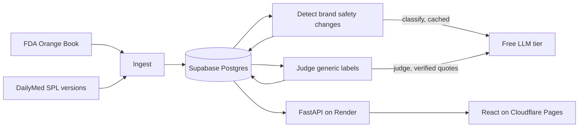

# Label Lag Radar

Research tool that measures how long generic drug labels take to show a brand drug's new safety
changes, using public DailyMed label versions and the FDA Orange Book.

**Not medical advice. Not a regulatory finding.** Dates are DailyMed publication dates, not the
dates companies made or submitted changes.

## How it works



1. **Ingest.** The Orange Book links brand (RLD) and generic applications. Each application's
   DailyMed label sets and all their versions are stored; safety sections are parsed by LOINC
   code and de-duplicated by hash.
2. **Detect.** Consecutive brand versions are diffed unit by unit. Added or changed units go to a
   classifier that drops editorial edits; substantive ones become safety events.
3. **Judge.** For each event and generic label, the matching text is retrieved (BM25 plus fuzzy
   match). Near-identical text is "reflected" and unrelated text is "not yet reflected" without a
   model call; otherwise a model judges and every quote must appear word for word. A binary search
   finds the first generic version that reflects the change, which gives the lag.
4. **Serve.** A read-only API and a React app show KPIs, a per-drug heatmap, the evidence for each
   judgement and the list of generics not yet reflecting changes (CSV export).

Full design: [docs/SPEC.md](docs/SPEC.md). Decisions: [docs/adr](docs/adr).

## Run locally

Requirements: Python 3.12 with [uv](https://docs.astral.sh/uv/), Node 22, Postgres 17.

```bash
cp backend/.env.example backend/.env      # fill in CONTACT_EMAIL, DATABASE_URL and an LLM key
cd backend
uv sync
uv run python -m app.db.migrate
uv run python -m app.worker ingest --drug warfarin --drug montelukast
uv run python -m app.worker detect --drug warfarin --drug montelukast --max-calls 40
uv run python -m app.worker judge  --drug warfarin --drug montelukast --max-calls 40
uv run uvicorn app.main:create_app --factory --reload   # API on http://localhost:8000/api/docs

cd ../frontend
npm ci
npm run dev                                # http://localhost:5173
```

`make dev`, `make test` and `make lint` (or `scripts/tasks.ps1` on Windows) wrap the same
commands; `docker compose up` starts Postgres, the API and the frontend together.

Tests: `uv run pytest` (integration tests need `TEST_DATABASE_URL`) and `npm test`.

## Deploy on free tiers

1. **Supabase.** Create a free project. Copy the transaction pooler URL (port 6543) as
   `DATABASE_URL` with the `postgresql+asyncpg://` scheme, and the session pooler URL (port 5432)
   as `DATABASE_URL_MIGRATIONS`. Run `uv run python -m app.db.migrate` once.
2. **LLM keys.** Create a free Google AI Studio key (and optionally Groq). Model names change on
   free tiers, so they are env values: `LLM_MODEL_CLASSIFY_google_genai`,
   `LLM_MODEL_JUDGE_google_genai`. Daily caps: `LLM_DAILY_CAP_google_genai`.
3. **Render.** New Blueprint from this repo ([render.yaml](render.yaml)). Fill the secret env vars,
   including `CORS_ORIGINS` with the Pages URL.
4. **Cloudflare Pages.** Root `frontend`, build `npm run build`, output `dist`, env
   `VITE_API_BASE_URL` set to the Render URL.
5. **GitHub Actions.** Add secrets `DATABASE_URL`, `DATABASE_URL_MIGRATIONS`, `CONTACT_EMAIL`,
   `GOOGLE_API_KEY` (and `GROQ_API_KEY`), and variables `LLM_MODEL_CLASSIFY_GOOGLE_GENAI`,
   `LLM_MODEL_JUDGE_GOOGLE_GENAI`. [nightly.yml](.github/workflows/nightly.yml) then ingests,
   detects and judges every night and can be started by hand from the Actions tab.

**Free-tier caveats.** The Render API sleeps when idle, so the first request after a pause is
slow. Supabase pauses after 7 idle days; the nightly job keeps it active. Free LLM quotas change
without notice; when a daily cap is hit the run stops with status `partial` and resumes the next
night from its cache. The database stops ingesting new text above `DB_SIZE_LIMIT_MB` (400).

## Known limits

- Dates are publication dates. A change may be pending at FDA or worded differently.
- Some brand labels are no longer on DailyMed (for example Coumadin); repackaged copies of the
  brand label then stand in as brand history, and their dates are less precise.
- Old-format labels split sections differently from PLR labels, so a format conversion can be
  detected as new text.
- Repackager labels copy their source and are excluded from counts by default.

## Scope

Built: ingestion, event detection, judging and lag, the public read API, and the dashboard, drug,
event, stale and methodology pages. Not built yet (see SPEC phases 6, 8 and 9 and the admin
endpoints in section 10): the LangGraph assistant, voice, the evaluation harness and the admin
screens.
